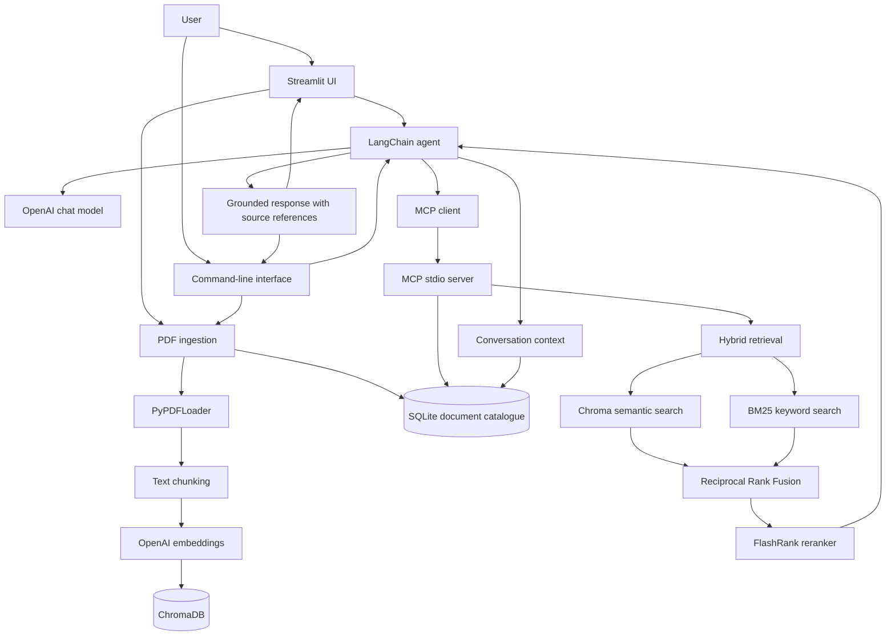
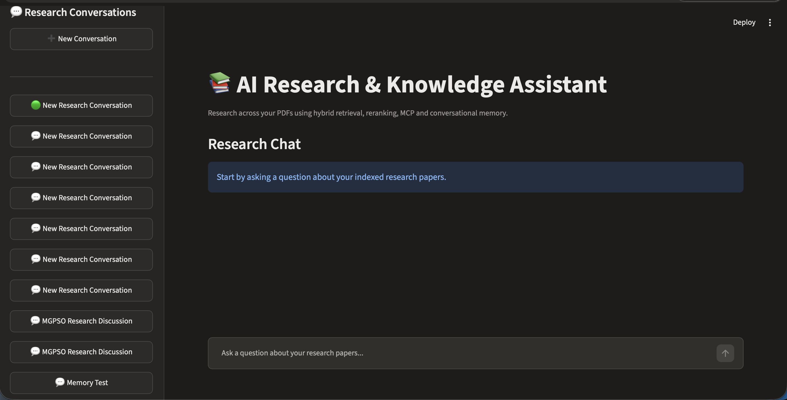
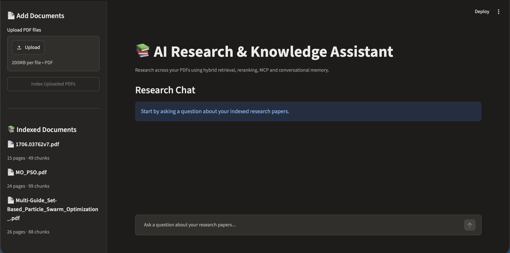
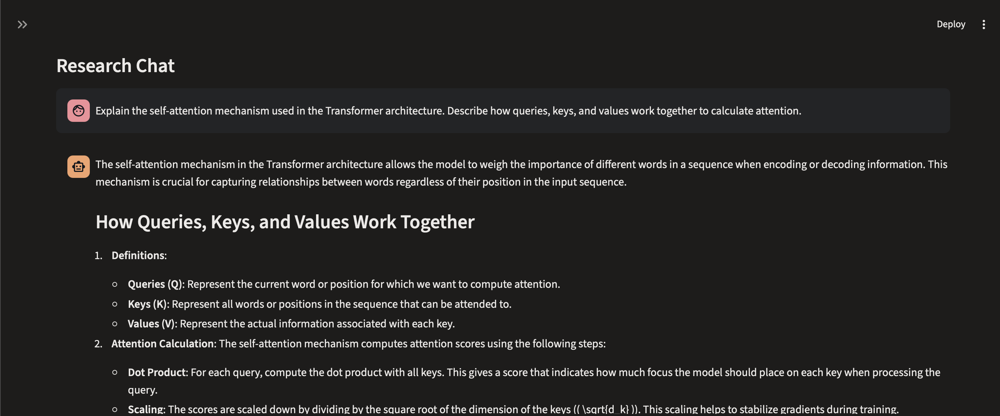
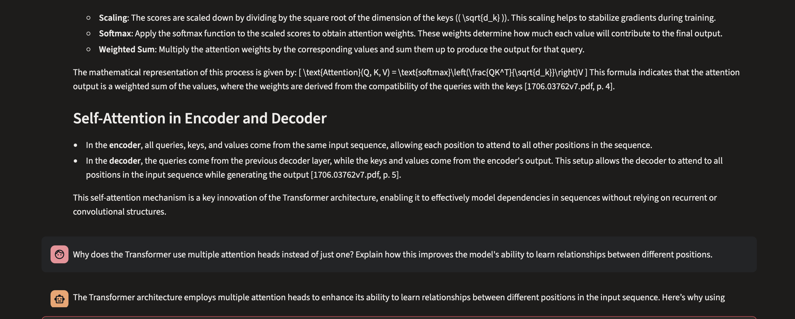
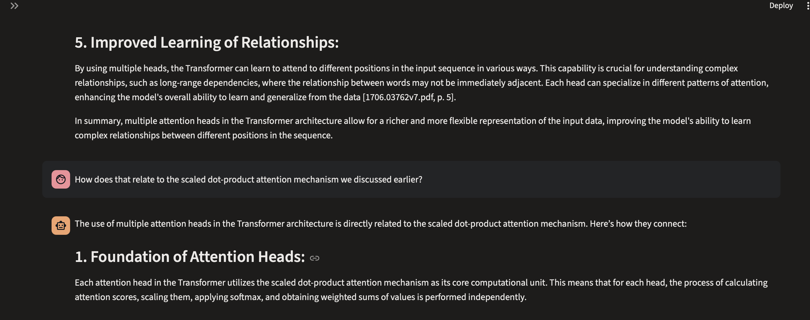

# AI Research & Knowledge Assistant

An AI-powered research assistant that lets you upload multiple research PDFs, retrieve relevant passages, and ask questions across your document collection.

The application combines **hybrid retrieval, FlashRank reranking, LangChain agent orchestration, Model Context Protocol (MCP), ChromaDB, SQLite, and Streamlit**.

It also supports **conversation history and context-aware follow-up questions**, so you can ask questions such as "How does that differ from the method in the other paper?" without repeating the entire context.

> **Project type:** Local AI engineering / portfolio project  
> **Status:** Core workflow implemented and tested locally  
> **Important:** This is an educational research assistant, not a production-grade or authoritative scientific system. Verify important claims against the original papers and cited pages.

---

## Highlights

- **Multi-PDF knowledge base:** Upload and index multiple research papers.
- **PDF ingestion:** Extract page-level text, split it into overlapping chunks, and retain document/page metadata.
- **Vector search:** Generate embeddings with OpenAI and store them persistently in ChromaDB.
- **Hybrid retrieval:** Combine semantic vector retrieval with BM25 keyword retrieval.
- **Reciprocal Rank Fusion (RRF):** Combine the ranked results from the semantic and keyword retrieval paths.
- **Neural reranking:** Use FlashRank (`ms-marco-TinyBERT-L-2-v2`) to rerank candidate passages for the user's query.
- **Agentic question answering:** Use a LangChain agent to decide when to call knowledge-base tools.
- **MCP integration:** Expose knowledge-base search and indexed-document listing through an MCP server using stdio transport.
- **Evidence-oriented answers:** Ground responses in retrieved passages and identify source documents and page numbers.
- **Conversational memory:** Save user and assistant messages in SQLite and include recent messages when answering follow-up questions.
- **Multiple conversations:** Start a new research conversation and switch between saved conversations in the Streamlit interface.
- **Two ways to interact:** Use the Streamlit interface or the command-line interface (CLI).

---

## Technology Stack

| Area | Technology |
|---|---|
| Programming language | Python |
| LLM and embeddings | OpenAI API |
| Agent orchestration | LangChain / LangGraph agent |
| Tool interoperability | Model Context Protocol (MCP), Python SDK |
| PDF extraction | PyPDFLoader |
| Text splitting | LangChain text splitters |
| Vector database | ChromaDB |
| Keyword retrieval | rank-bm25 |
| Reranking | FlashRank |
| Application database | SQLite |
| User interface | Streamlit |
| Testing | pytest |

---

## Architecture

The application follows a modular architecture that separates document ingestion, retrieval, agent orchestration, tool communication, and conversation persistence.



### Request Lifecycle

1. A user uploads research PDFs through Streamlit or places PDFs in the configured documents directory.
2. The ingestion pipeline extracts text page by page.
3. The extracted text is divided into overlapping chunks with source and page metadata.
4. OpenAI embeddings are generated and stored in ChromaDB.
5. When a question is submitted, the LangChain agent can call the MCP knowledge-base tools.
6. The retrieval pipeline obtains semantic and BM25 keyword results.
7. Reciprocal Rank Fusion combines the result rankings.
8. FlashRank reranks the candidate passages for the current query.
9. The agent uses retrieved evidence and recent conversation messages to prepare an answer.
10. The question and answer are persisted in SQLite for later conversation-history display.

---

## Project Structure

```text
research-knowledge-assistant/
│
├── research_assistant/
│   ├── __init__.py
│   ├── agent.py             # LangChain agent and MCP client integration
│   ├── cli.py               # Command-line interface
│   ├── config.py            # Paths and configuration
│   ├── db.py                # SQLite catalogue and conversation persistence
│   ├── ingest.py            # PDF extraction, chunking and indexing
│   ├── mcp_server.py        # MCP tools exposed to the agent
│   └── retrieval.py         # Hybrid retrieval, RRF and FlashRank reranking
│
├── tests/
│   ├── test_cli.py
│   └── test_db.py
│
├── screenshots/
│   ├── dashboard.png
│   ├── documents.png
│   ├── conversational_memory_01.png
│   ├── conversational_memory_02.png
│   └── conversational_memory_03.png
│
├── data/                    # Local document and vector database storage
│
├── app.py                   # Streamlit application
├── .env.example             # Environment variable template
├── .gitignore
├── pyproject.toml
├── requirements.txt
└── README.md
```

Generated data, local databases, API credentials, research documents, and virtual environments should remain out of version control. Check `.gitignore` before publishing the repository.

---

## Prerequisites

Before installing the application, ensure you have:

- Python 3.11 or 3.12.
- An OpenAI API key with access to the configured chat and embedding models.
- Internet connectivity for OpenAI API requests and initial model downloads.
- macOS, Linux, or Windows.

---


## Running the Application

The application supports two interaction methods: a Streamlit graphical interface and a command-line interface.

### Option A: Streamlit Interface

Run:

```bash
python -m streamlit run app.py
```

On the development machine where the project was tested, the explicit virtual-environment interpreter can also be used:

```bash
./.venv/bin/python -m streamlit run app.py
```

Open the local URL printed by Streamlit, usually:

```text
http://localhost:8501
```

In the application:

1. Upload one or more PDF research papers in the sidebar.
2. Select **Index Uploaded PDFs**.
3. Wait for the ingestion status to confirm that the documents were indexed.
4. Ask a question in the chat input.
5. Ask follow-up questions in the same conversation.
6. Use **New Conversation** to start a separate discussion.
7. Select a saved conversation in the sidebar to return to it.

Conversation messages are stored in SQLite and loaded when a conversation is selected again.

### Option B: Command-Line Interface

**Ingest all PDFs from the configured documents directory:**

```bash
research-assistant ingest
```

**Ingest one PDF:**

```bash
research-assistant ingest "/absolute/path/to/research-paper.pdf"
```

**List indexed documents:**

```bash
research-assistant list
```

**Ask a question:**

```bash
research-assistant ask "Summarize the main contribution of the indexed papers."
```

**More example questions:**

```bash
research-assistant ask "Compare the methods used in the indexed papers."

research-assistant ask "What limitations are discussed in these papers?"

research-assistant ask "Which paper describes the multi-guide mechanism?"
```

**View recent research history:**

```bash
research-assistant history --limit 10
```

If the CLI entry point is unavailable, try:

```bash
python -m research_assistant.cli --help
```

---

## Retrieval Pipeline

The retrieval module uses a multi-stage approach rather than relying only on vector similarity.

### 1. Semantic Retrieval

The user's query is embedded and compared with document chunk embeddings stored in ChromaDB.

This helps retrieve passages that are conceptually related even when they do not use exactly the same words as the query.

### 2. Keyword Retrieval with BM25

BM25 ranks passages based on lexical overlap with the query.

It can help when a question contains specific terminology, acronyms, algorithm names, or technical phrases.

### 3. Reciprocal Rank Fusion

The semantic and keyword result lists are combined using Reciprocal Rank Fusion (RRF).

RRF uses the relative ranking of a result in each retrieval list to produce a combined ranking.

### 4. FlashRank Reranking

A candidate set from the fused results is passed to FlashRank.

The reranker evaluates query-passage relevance and returns a reordered list of passages.

### Why Combine These Stages?

- Vector retrieval helps with semantic similarity.
- BM25 helps with exact terms and technical vocabulary.
- RRF combines complementary retrieval rankings.
- Reranking gives a more query-focused ordering to the candidate passages.

The quality of the final answer still depends on the source documents, extraction quality, retrieval settings, and model interpretation. Retrieval scores are not probabilities that an answer is correct.

---

## MCP Tools

The local MCP server exposes tools that the LangChain agent can call:

| Tool | Purpose |
|---|---|
| `search_knowledge_base(query, k)` | Retrieve relevant passages from the indexed knowledge base. |
| `list_indexed_documents()` | List documents available in the local index. |

The agent connects to the MCP server through stdio transport.

This is a local development arrangement; it is not an authenticated public MCP service.

---

## Conversational Memory

Conversation persistence is implemented with SQLite.

The database stores:

- Conversation identifiers and titles.
- Conversation creation and update timestamps.
- User messages.
- Assistant responses.

When a user asks a follow-up question, recent messages from that conversation are loaded and supplied as context to the agent.

This supports follow-ups that refer to earlier discussion.

Conversation memory is scoped by conversation ID. Starting a new conversation creates a separate context rather than reusing the previous conversation's message history.

---

## Testing

Run the available automated tests:

```bash
python -m pytest -v
```

The repository's included tests cover the components represented in the `tests/` directory.

They do not necessarily exercise every live integration, such as OpenAI API calls, embedding generation, ChromaDB retrieval, FlashRank, MCP communication, or the full Streamlit workflow.

### Practical End-to-End Check

1. Configure a valid API key.
2. Start the application.
3. Index a small, text-based PDF.
4. Ask a question whose answer is present in the PDF.
5. Check that the response refers to the relevant source and page.
6. Ask a follow-up question in the same conversation.
7. Start a new conversation and confirm that it has separate chat history.

---

## Application Screenshots

The following screenshots demonstrate the application's document management interface and conversational research capabilities.

### 1. Main Dashboard and Document Management

The Streamlit interface provides PDF uploading, document indexing, and access to the indexed research collection.





### 2. Conversational Research and Context Retention

The assistant supports multi-turn conversations, allowing users to ask follow-up questions while retaining the context of previous interactions.

**Initial Research Question**

The assistant retrieves information from the indexed Transformer paper and explains the self-attention mechanism, including queries, keys, and values.



**Contextual Follow-up**

The user asks about multi-head attention. The assistant provides an explanation grounded in the same research document.



**Further Contextual Reasoning**

The user refers to the previously discussed scaled dot-product attention mechanism. The assistant uses the conversation context to explain how the concepts relate.



---

## Limitations

- The application requires a valid OpenAI API key for model and embedding requests.
- Initial model downloads for reranking require internet connectivity.
- PDF extraction quality depends on the structure and readability of the source documents.
- Scanned PDFs may require OCR support, which is not described as an implemented feature here.
- Retrieval quality depends on chunking, embeddings, ranking, and the available document collection.
- Answers should be verified against original research papers before being used in academic or professional work.
- The MCP server is configured for local stdio communication rather than public authenticated access.

---

## Future Improvements

Potential extensions include:

- Add OCR support for scanned research papers.
- Add document-level filters and metadata-based retrieval.
- Improve evaluation using a curated question-and-answer dataset.
- Add retrieval quality metrics and benchmarking.
- Support additional embedding and language models.
- Add authentication and multi-user support.
- Containerize the application using Docker.
- Deploy the application to AWS using ECS and a CI/CD pipeline.

These are possible future enhancements, not claims about currently implemented functionality.

---

## Learning Outcomes

This project provides practical experience with:

- Building LLM-powered applications using Python.
- Working with LangChain agents and tool calling.
- Understanding the Model Context Protocol (MCP).
- Implementing PDF ingestion and document processing.
- Building a vector-based knowledge base using ChromaDB.
- Combining semantic and keyword search through hybrid retrieval.
- Applying Reciprocal Rank Fusion and neural reranking.
- Implementing persistent conversational memory using SQLite.
- Building interactive applications using Streamlit.
- Structuring, testing, and documenting a modular Python project.

---

## License

Choose and add an appropriate open-source license before distributing the project. No license is specified by this README.

